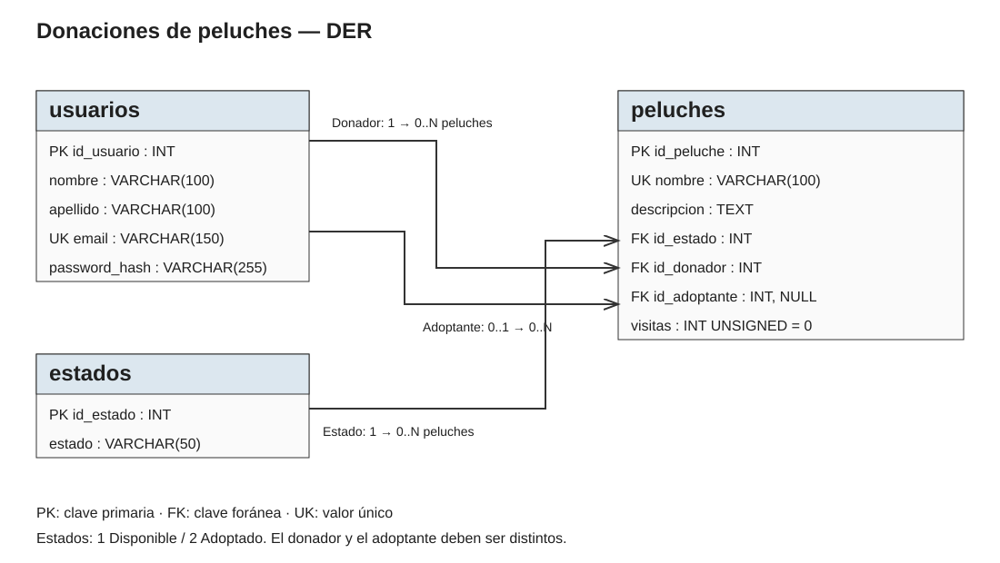
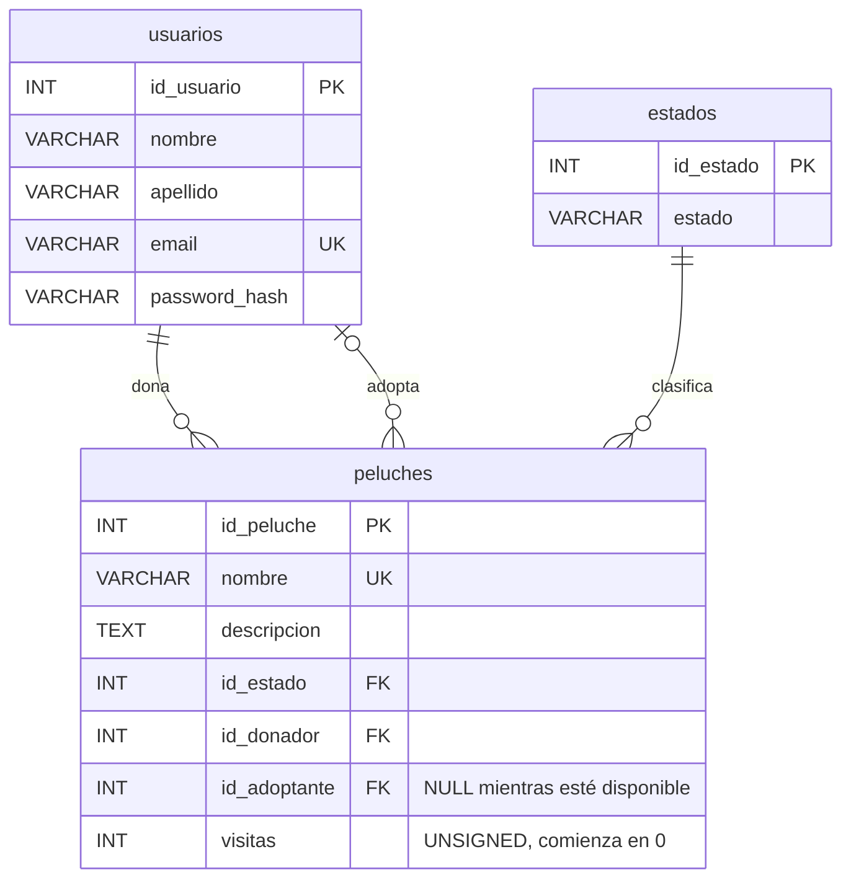

# Diagrama entidad-relación

- Un usuario puede donar varios peluches; cada peluche tiene un donador.
- Un usuario puede adoptar varios peluches; cada peluche tiene cero o un adoptante.
- `estados` contiene `1 = Disponible` y `2 = Adoptado`.
- `adopcion_coherente` impide estados incompatibles con el adoptante y la adopción propia.
- Email y nombre de peluche tienen restricciones `UNIQUE`. La comparación ignora mayúsculas y acentos (`utf8mb4_unicode_ci`).
- Las visitas son accesos a la página, no personas únicas; cada GET válido suma uno con una operación SQL atómica.
- Las claves foráneas impiden referencias a usuarios o estados inexistentes. El borrado del peluche es físico y no borra usuarios.
